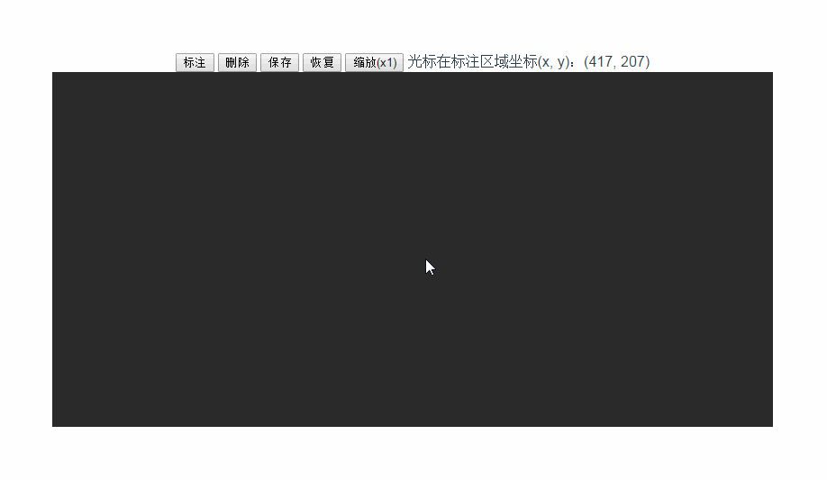

# vue-canvas（Vue 3 分支）

> 在 Vue 3 + TypeScript 下使用 Canvas 组件进行多边形标注。



## 快速开始

需要 Node.js `>= 22.12` 与 npm `>= 10`（CI 与容器统一使用 Node 24 LTS）。

```bash
npm ci          # 依赖已锁定在 package-lock.json
npm run dev     # 开发服务器，默认 http://localhost:8081
npm run build   # 类型检查 + 生产构建，输出到 dist/
npm run preview # 预览生产构建
```

复制 `.env.example` 为 `.env.local` 可配置端口与 `/api` 代理目标（`VITE_PROXY_TARGET`）。

## 常用脚本

| 命令                                      | 作用                          |
| ----------------------------------------- | ----------------------------- |
| `npm run dev`                             | 启动 Vite 开发服务器          |
| `npm run build`                           | `vue-tsc` 类型检查 + 生产构建 |
| `npm run typecheck`                       | 仅做严格类型检查              |
| `npm run lint` / `npm run lint:fix`       | ESLint 9 检查 / 修复          |
| `npm run format` / `npm run format:check` | Prettier 格式化 / 检查        |
| `npm run test` / `npm run coverage`       | Vitest 单测 / 覆盖率          |

CI 位于 `.github/workflows/ci.yml`，对 lint、格式、类型、测试、构建全量把关。

## 目录结构

```
src/
├── main.ts                  应用入口（createApp + Pinia + Router）
├── App.vue                  根组件与跳转主内容链接
├── router/index.ts          vue-router 4，单路由 + 404 回退
├── stores/annotation.ts     Pinia：标注态、数据集、缩放、持久化
├── views/ExampleView.vue    演示页：工具栏、导入导出、状态提示
├── components/MyCanvas.vue  双层 Canvas 标注组件（核心）
├── common/
│   ├── types.ts             共享数据类型
│   ├── constants.ts         阈值、状态、配色
│   ├── geometry.ts          纯几何算法
│   ├── Point.ts / Polygon.ts 点 / 多边形模型
│   └── dataset.ts           数据校验、深拷贝、缩放、序列化
├── assets/back.png          示例底图
└── styles/main.css          设计变量与基础样式
tests/                       Vitest 单测（几何、数据、模型、组件）
docs/canvas.gif              效果演示（不进入构建产物）
```

## 交互说明

- **标注模式**：逐点点击绘制，靠近起点（25px 内）自动闭合；未闭合时右键或 `Escape` 取消；`Enter` 直接闭合。
- **编辑模式**：点击图形内部选中，拖动顶点微调，拖动内部整体平移；`Delete` 删除选中图形，方向键（按住 `Shift` 加速）移动选中图形。贴边拖动会自动把位移裁剪到画布内并允许沿边界滑动，反向拖动立即响应。
- **约束**：绘制第二个及之后的图形时，每加一个点都会实时校验新线段是否与已有图形交叉（受阻时橡皮筋变红并拒绝该点）；闭合前还会校验最后一条闭合边与整体重叠；同时禁止自身边交叉与越界。把组件的 `allowOverlap` 设为 `true` 可关闭该限制。
- **数据**：`change` 事件实时把工作区同步到 Pinia 与 `localStorage`；「保存到本地」额外生成一份独立快照，不受后续删除、清空影响，「恢复图形」始终从快照重建画布，因此保存后删除仍可恢复；另可导出/导入 JSON 文件。
- **缩放**：倍率由 store 统一管理（`x0.5` ~ `x2`），坐标、画布尺寸与字号同倍率变化。
- **可访问性**：画布可聚焦并有 `aria-label`/说明文本/`aria-live` 状态，支持键盘与 Pointer（鼠标/触摸/触控笔）事件，按钮带 `type` 与 `aria-pressed`，有可见焦点样式。

## 数据格式

```json
[
  {
    "points": [
      { "x": 254, "y": 106 },
      { "x": 165, "y": 213 },
      { "x": 260, "y": 316 }
    ],
    "text": "Text desc"
  }
]
```

导入时会严格校验：数组结构、至少 3 个顶点、坐标为有限数值、`text` 为字符串。

## 相对旧（master，Vue 2）分支的修复

- 迁移 Vue 3 + Vite + TypeScript + Pinia + vue-router 4，替换 EOL 的 webpack 2 / Babel 6 / Karma / PhantomJS / Vuex 2。
- 补 `package-lock.json`、ESLint 9 + Prettier + 严格 `tsconfig` + CI；删除失效的 `Hello.spec.js` 与整套 vue-cli 模板残留。
- 组件用 `ref` 获取画布并支持多实例，替换固定 DOM id 与全局 id 选择器；补 `devicePixelRatio` 高清适配。
- 统一 Pointer 事件（鼠标/触摸）与键盘操作，补 ARIA、焦点样式、语义化结构与 viewport/favicon/描述。
- 用纯几何算法替代 `isPointInPath` 重绘命中；新增自交、多边形重叠、越界检测与文案位置/字号自适应。
- 修复 `ctx.setDashOffset`、`Ploygon` 类名拼写、恒假的闭合条件、未声明的 `this.x/y`、直接修改 prop、`hasOwnProperty` 裸调用等问题。
- 缩放改为纯函数深拷贝，根除数据集与恢复数据间的引用污染；尺寸变化不再覆盖未保存的编辑。
- `mousemove` 全量重绘改为 `requestAnimationFrame` 节流，底图层只在图片/尺寸变化时重绘。
- 清理死代码、注释掉的调试语句与 `console.log`；生产关闭 sourcemap，演示 GIF 移出 `static/` 不再进入产物。
- 新增覆盖几何算法、数据校验、多边形模型与组件交互的 Vitest 单测。

## 部署

```bash
docker build -t vue-canvas .
docker run -p 8080:8080 vue-canvas
```

多阶段 `Dockerfile` 用 `npm ci` 复现依赖并构建，运行时使用非 root 的 nginx 镜像。`deploy/nginx.conf` 提供 SPA history 回退、静态资源长缓存、gzip、CSP 与安全响应头；部署到自有网关时请按实际域名调整 CSP。`index.html` 不内联 CSP，生产构建默认不生成 sourcemap。
